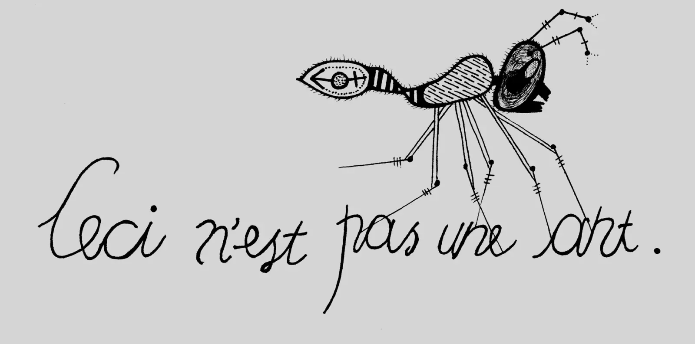

# Daniel Ari Friedman, PhD

I study how systems make sense of the world, from [harvester ant colonies](domain-entomology.html) to [Active Inference models](domain-active-inference.html) and [information ecosystems](domain-cognitive-security.html). I build open-source research tools, teach biology, and draw in pen and ink.

[Research website](https://danielarifriedman.com/) · [Search](search.html) · [Publications](publications.html) · [Software](software.html) · [CV](resume/resume.pdf)

[Research domains](#research-domains) · [Featured projects](#featured-projects) · [Interactive tools](#interactive-tools) · [Reading trails](#reading-trails) · [Teaching and media](#teaching-and-media) · [Art](#art) · [Sources and reuse](#sources-and-reuse)

## Research domains

| Domain | Start with | Follow the connections |
| --- | --- | --- |
| [Entomology and collective behavior](domain-entomology.html) | [Dopamine and collective regulation of foraging](works/Friedman2018RoleDopamineCollectiveRegulation100.html) · [Gene expression in forager brains](works/Friedman2020GeneExpressionVariationBrains086.html) | [Ants and collectives trail](trails.html#ants-and-collectives) · [Foraging research on the map](research-map.html?node=work%3AFriedman2018RoleDopamineCollectiveRegulation100) |
| [Active Inference](domain-active-inference.html) | [Free Energy Principle literature analysis](works/Friedman2022FreeEnergyPrincipleActive073.html) · [Federated inference and belief sharing](works/Friedman2024FederatedInferenceBeliefSharing036.html) | [Foundations trail](trails.html#active-inference-foundations) · [Active Inference on the map](research-map.html?node=domain%3Aactive%20inference) |
| [Cognitive security](domain-cognitive-security.html) | [Memes and narrative information ecosystems](works/Friedman2024BridgingGapsImageMeme031.html) · [Narrative information ecosystems and conflict](works/Friedman2021NarrativeInformationEcosystemsConflict079.html) | [Information commons trail](trails.html#cognitive-security) · [Cognitive Security and Education Forum](pages/PROFILE.md#cogsecorg-cognitive-security-and-education-forum) |
| [Art and Synergetics](domain-art-synergetics.html) | [William Blake and Buckminster Fuller](works/Friedman2023WilliamBlakeBuckminsterFuller065.html) · [Fourfold vision and William Blake](works/Friedman2026FourfoldVisionWilliamBlake196.html) | [William Blake publication pathway](blake-pathway.html) · [Artwork gallery](art.html) |
| [Computational methods](domain-computational.html) | [A template for reproducible research](works/Friedman2026TemplateApproachReproducibleGenerative001.html) · [Discovery Engine](works/Friedman2025DiscoveryEngineAIDriven026.html) | [Reproducibility trail](trails.html#reproducible-research) · [Software catalog](software.html) |
| [Genetics and biomedicine](domain-biomedicine.html) | [Coding sequence change in honey bees](works/Friedman2015LargeScaleCodingSequence108.html) · [Nuclear structure and radiation damage](works/Friedman2016InfluenceNuclearStructureFormation105.html) | [Genetics and biomedicine on the map](research-map.html?node=domain%3Agenetics%20%26%20biomedical) |
| [Active Inference Institute ecosystem](domain-aii-ecosystem.html) | [Active Inference Institute overview](works/Friedman2025ActiveInferenceInstituteActive024.html) · [Coordinating the field](works/Friedman2026CoordinatingFieldCaseEcosystem224.html) | [Institute programs](pages/PROFILE.md#active-inference-institute) · [Institute software](pages/SOFTWARE.md#active-inference-institute) |
| [Presentations and media](domain-presentations-media.html) | [Active Inference Journal video archive](works/Friedman2026ActiveInferenceJournal500002.html) · [2026 Active Inference Symposium](works/Friedman20262026ActiveInferenceSymposium237.html) | [Talks and courses](media.html) · [Video archive](videos.html) |

## Featured projects

| Project | What to explore | Paper, code, and citation |
| --- | --- | --- |
| **py-CIPro** | Exact geometry of complete-intersection Calabi–Yau threefolds, including a local dashboard for exploring the archived configurations | [Work page](works/Friedman2026PyCIProExactGeometry240.html) · [Code](https://github.com/docxology/py-CIPro) · [Zenodo v0.9.3](https://doi.org/10.5281/zenodo.24352380) |
| **CrossTalk on the Page** | How the defense software engineering journal presented its work in words and images | [Work page](works/Friedman2026CrossTalkPage239.html) · [Code](https://github.com/docxology/CrossTalk-study) · [Zenodo v0.1.0](https://doi.org/10.5281/zenodo.24297224) |
| **Rikishi** | Reproducible operation and analysis of the Suggested Upper Merged Ontology (SUMO) | [Work page](works/Friedman2026RikishiReproducibleOperationAnalysis236.html) · [Code](https://github.com/docxology/rikishi) · [Zenodo](https://doi.org/10.5281/zenodo.23987670) |
| **States Change** | William Blake's account of persons, changing states, and political federation | [Work page](works/Friedman2026StatesChangeBlakeanFederalism234.html) · [Code](https://github.com/docxology/Blakean_Federalism) · [Zenodo](https://doi.org/10.5281/zenodo.23900616) |

## Interactive tools

| Try it | What you can do |
| --- | --- |
| [Bayesian update](lab.html#bayes) | Change the prior and compare how positive and negative observations move the posterior. |
| [Reinforced urn](lab.html#urn) | Change the starting mix, draw tokens, and compare how repeated reinforcement shapes the outcome. |
| [Research map](research-map.html?node=work%3AFriedman2026CrossTalkPage239) | Start at the CrossTalk study and follow its connections to related works, contributors, and software. |
| [Publication filters](publications.html?doi=1&docs=1) | Start with works that have both a DOI and paper documentation. Refine the results by year, type, or domain. |
| [Reading list](collections.html#v=1&title=Research%20methods&works=Friedman2026CrossTalkPage239%2CFriedman2026PyCIProExactGeometry240) | Open a two-paper preview, reorder or add works, and export BibTeX or RIS. |
| [Catalog search](search.html?q=Active%20Inference) | Search works, software, site pages, people, organizations, and evidence from one place. |

## Reading trails

| Trail | Route |
| --- | --- |
| [From probability to Active Inference](trails.html#active-inference-foundations) | Start with a [Bayesian update](lab.html#bayes), read the [Free Energy Principle literature analysis](works/Friedman2022FreeEnergyPrincipleActive073.html), then explore [Generalized Notation Notation](works/Friedman2023GeneralizedNotationNotationActive056.html). |
| [Ants, reinforcement, and collective behavior](trails.html#ants-and-collectives) | Try the [reinforced urn](lab.html#urn), then read how [forager hydration](works/Friedman2019PhysiologyForagerHydrationVariation095.html) and [dopamine](works/Friedman2018RoleDopamineCollectiveRegulation100.html) affect ant foraging. |
| [Information commons and cognitive security](trails.html#cognitive-security) | Move from [narrative ecosystems](works/Friedman2021NarrativeInformationEcosystemsConflict079.html) to the [design of an information commons](works/Friedman2022StructuringInformationCommonsOpen071.html). |
| [From research teams to reproducible artifacts](trails.html#reproducible-research) | Read the [research template paper](works/Friedman2026TemplateApproachReproducibleGenerative001.html), then find the underlying artifacts in the [data catalog](catalog.html). |

## Teaching and media

| Program | Materials |
| --- | --- |
| **College of the Redwoods** | [BIOL-1 General Biology](https://github.com/docxology/biol-1) at Pelican Bay, Spring and Fall 2026 · [BIOL-8 Human Biology](https://github.com/docxology/biol-8), Spring 2026 |
| **Active Inference Textbook Group** | Nine completed cohorts on [Parr, Pezzulo & Friston's 2022 textbook](https://direct.mit.edu/books/oa-monograph/5299/Active-InferenceThe-Free-Energy-Principle-in-Mind) and a first cohort on [Namjoshi's 2026 Fundamentals](https://mitpress.mit.edu/9780262050951/fundamentals-of-active-inference/). [Course and cohort links](pages/VIDEOS.md#active-inference-textbook-groups) |
| **Talks and recorded discussions** | [Conference talks](pages/MEDIA.md#conference-presentations) · [Podcasts and interviews](pages/MEDIA.md#podcast--interview-appearances) · [Video archive](videos.html) |

## Art

[Pen-and-ink gallery](art.html) · [Curio Cards](art.html#curio-cards) · [Blake and Fuller](works/Friedman2023WilliamBlakeBuckminsterFuller065.html)

See the pen-and-ink ant

*Pen and ink by Daniel Ari Friedman.*

## Sources and reuse

| Looking for | Go directly to |
| --- | --- |
| **Publications and paper guides** | [Searchable bibliography](publications.html) · [Bibliography source table](pages/BIBLIOGRAPHY.md) · [Paper folders](papers/) |
| **Code and repositories** | [Curated software catalog](software.html) · [Primary repository inventory](repositories.html) · [Fork archive](repositories-forks.html) |
| **Citations and data** | [BibTeX](bibliography.bib) · [CSL JSON](bibliography.csl.json) · [RIS](bibliography.ris) · [Works JSON](data/works.json) · [All exports](exports.html) |
| **Evidence and source notes** | [Cite and verify](cite-verify.html) · [Claim ledger](evidence.html) · [Collection counts](reports/current_counts.md) · [Scholar snapshot](data/scholar-snapshot.json) · [Discovery map](discovery.html) |
| **About and contact** | [Full biography](pages/PROFILE.md) · [Collaborators](pages/COLLABORATORS.md) · [Contact and links](pages/LINKS.md) |
| **Research profiles** | [ORCID](https://orcid.org/0000-0001-6232-9096) · [Google Scholar](https://scholar.google.com/citations?user=DXjPFtYAAAAJ&hl=en) · [Wikidata](https://www.wikidata.org/wiki/Q138781444) |
| **Maintaining this repository** | [Agent start guide](AGENT_START.md) · [Project skill](SKILL.md) · [Documentation index](docs/README.md) · [Generated outputs](GENERATED.md) · [Changelog](CHANGELOG.md) |
